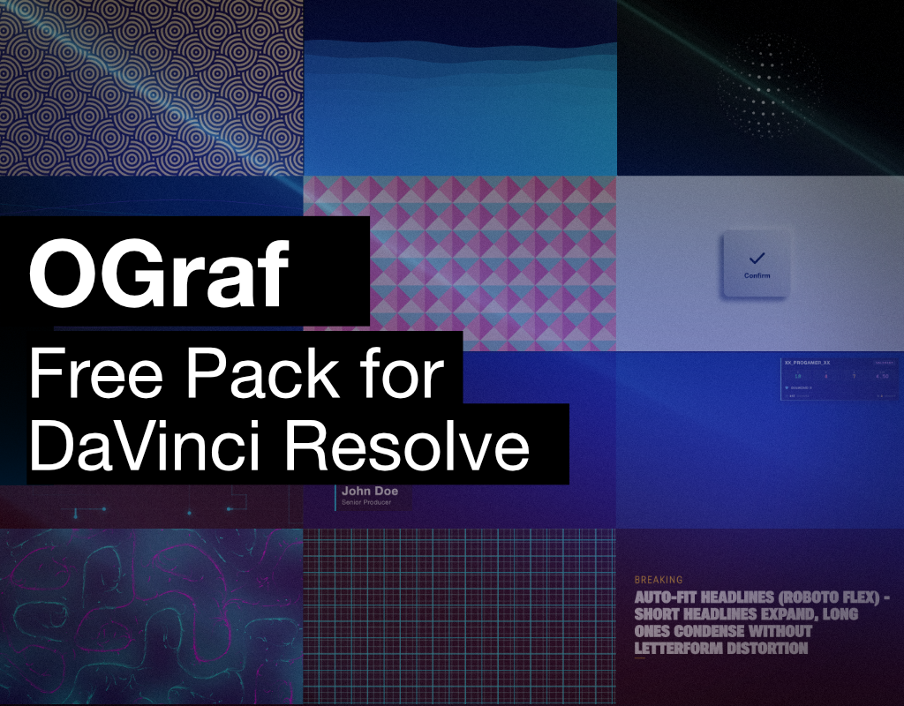

# OGraf Free Pack for DaVinci Resolve

16 free OGraf graphics for the OGrafLoader in DaVinci Resolve Fusion: backgrounds, lower thirds, an AI orb spinner and a data overlay.

## Requirements

- DaVinci Resolve 21.1.1 or later with OGrafLoader. Tested on macOS with Resolve 21.1.2.
- Windows has not been tested yet.
- Auto-Fit Headline loads Roboto Flex from fonts.googleapis.com and needs an internet connection.

## Install

1. Download the latest zip from [Releases](../../releases) or clone this repo.
2. Copy the `OGraf-Free` folder into the Resolve Titles templates folder:
   - macOS: `~/Library/Application Support/Blackmagic Design/DaVinci Resolve/Fusion/Templates/Edit/Titles/`
   - Windows (untested): `%APPDATA%\Blackmagic Design\DaVinci Resolve\Support\Fusion\Templates\Edit\Titles\`
3. Restart Resolve. Keep each graphic's folder together, because it loads its scripts from there.

## Use

In Fusion, add an `OGrafLoader` node and set its file to a graphic's `.ograf.json`. Play runs the intro, Stop runs the outro.

Ready-made Fusion comps are in `settings/` (one `.setting` per graphic) and `comps/comps-free.comp` (all graphics in one comp). They expect the pack installed as `OGraf-Free` in the Titles folder as above.

Full control lists for every graphic are in the [documentation page](docs/index.html).

## Graphics

| Graphic | What it is |
| --- | --- |
| Auto-Fit Headline | News headline that fills a fixed-width container by adjusting the Roboto Flex wdth axis instead of CSS transform:scaleX() |
| Cyber Grid | Animated cyberpunk/synthwave grid background |
| Data Lower Third | Lower third driven by a local JSON data file |
| Digital Circuit | High-tech grid with signal tracers |
| Dot Lattice | Animated dot-lattice background pattern |
| Flow Field | Simplex noise flow field with blurred background grid + particle layer |
| Gaming Stats Overlay | Esports/streaming HUD with K/D/A stats, rank, viewer count and win streak |
| JSON Lower Third | Name and title loaded from a data file on disk |
| Lower Third Switcher | Two lower-third layouts in one graphic |
| Neumorphic Pulse | Soft-UI neumorphic panel that raises in, periodically presses/releases like a button, then raises back out |
| Pinwheel | Animated four-colour pinwheel pattern |
| Sine Wave | Multiple layered sine waves drifting across the screen with organic interference patterns |
| Staggered Lower Third | Lower third with staggered text reveal |
| Thinking Orbs | Dotted thought-orb spinner for AI/agent states |
| Wave Interference | Layered sine-wave interference patterns |
| Weave Pattern | Animated herringbone/weave background pattern |

## Licence

MIT, see [LICENSE](LICENSE).
Bundled third-party material (Thinking Orbs, Roboto Flex, Uiverse.io snippets) is listed in [THIRD_PARTY_NOTICES.md](THIRD_PARTY_NOTICES.md).

## More

Paid packs and other tools: [ko-fi.com/dunnlewis](https://ko-fi.com/dunnlewis)
